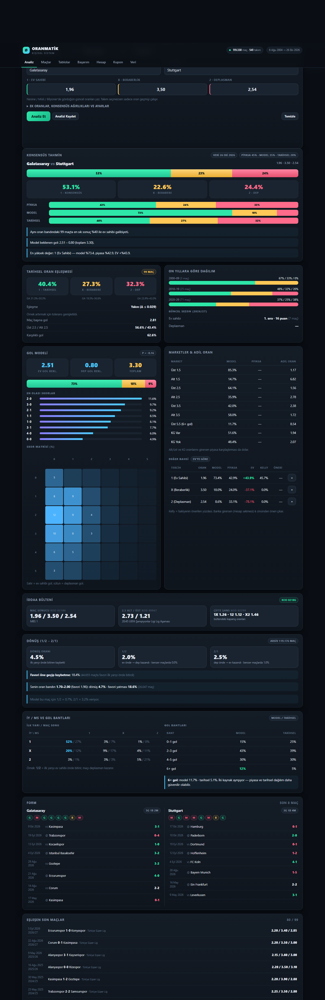
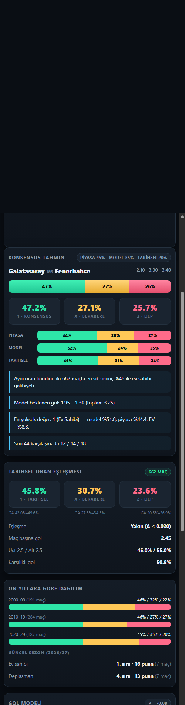
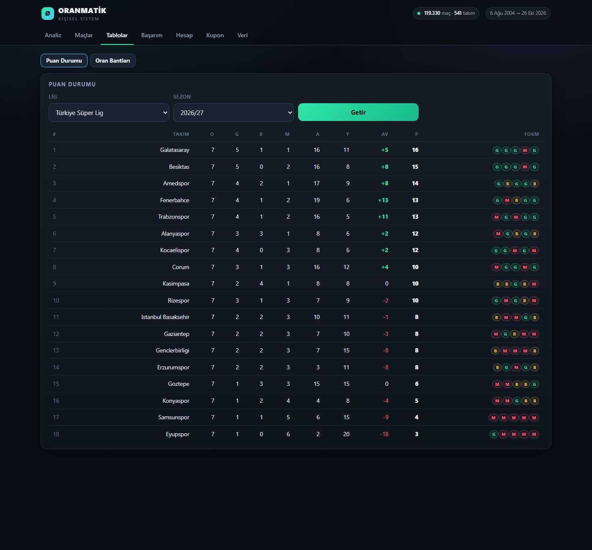
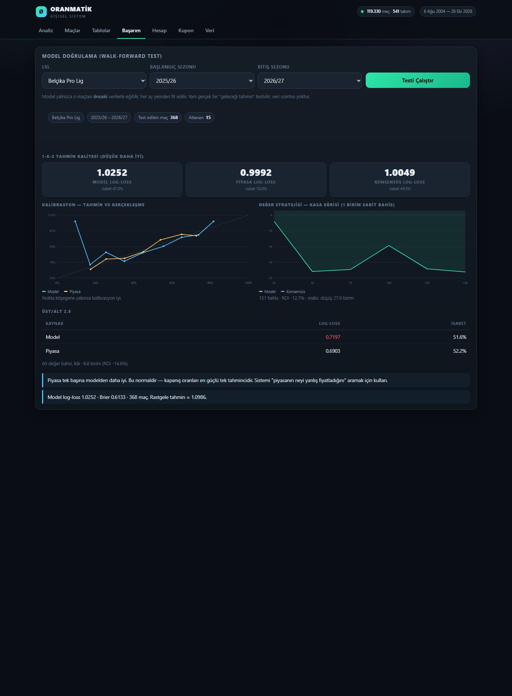
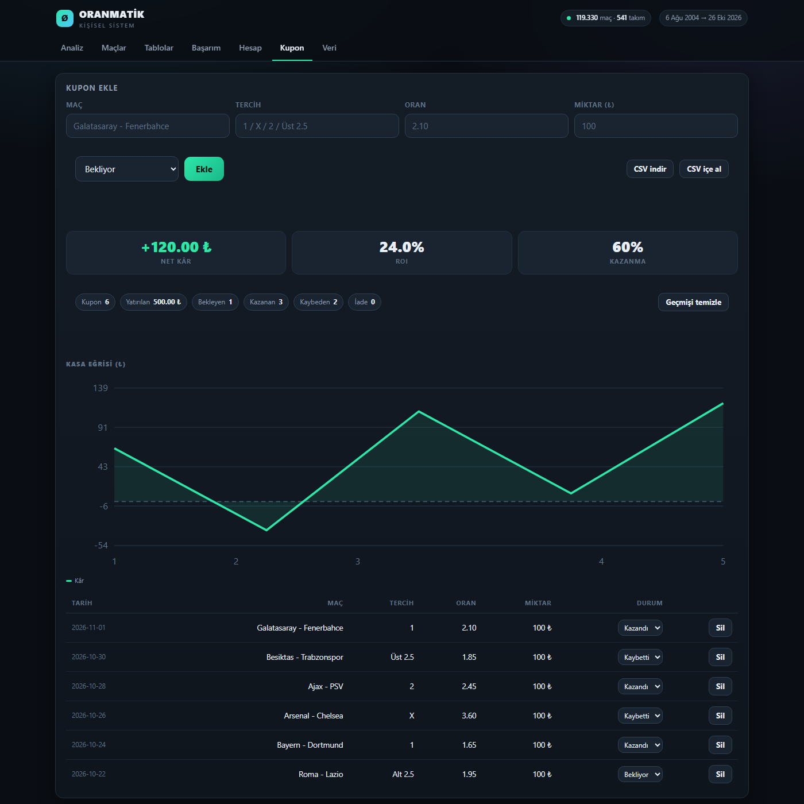

# OranMatik — bwin oran analiz sistemi (web)

**Site:** https://onurkahraman-coder.github.io/oranmatik/

Tarayıcıda çalışan, kendini her 3 saatte bir güncelleyen maç oranı analiz sistemi.
**Tüm 1-X-2 oranları bwin'dir**: geçmiş maçlarda açılış (2004–) ve kapanış (2019/20–), oynanacak maçlarda açılış oranı.

## Nasıl güncel kalıyor

`.github/workflows/guncelle.yml` — GitHub Actions, 3 saatte bir (ve her push'ta):

1. `tools/update-live.js` → güncel sezonun 16 lig dosyası football-data.co.uk'den (ulaşılamazsa İnternet Arşivi),
   veritabanı derlenir, oynanacak maçlar + bwin oranları (`fixtures.csv`), günün bülteni (ESPN)
2. `tools/test.js` → otomatik testler (başarısızsa yayın yapılmaz, eski site kalır)
3. `tools/web.js` → `site/` statik sitesi → GitHub Pages
4. Güncel ham veri depoya geri yazılır (depo aktif kalır, zamanlanmış çalışma durmaz)

Elle tetiklemek: depo → **Actions** → *Veriyi guncelle ve yayinla* → **Run workflow**.

Yerelde: `node tools/build.js && node tools/web.js` → `site/` klasörünü herhangi bir statik sunucuyla aç
(ya da eski usul `baslat.cmd` → http://localhost:5178).

## Neler bwin, neler hesap

| | Kaynak |
|---|---|
| 1-X-2 (geçmiş, açılış) | bwin · 2004/05'ten beri, maçların %98'i |
| 1-X-2 (geçmiş, kapanış) | bwin · 2019/20'den beri |
| 1-X-2 (oynanacak maçlar) | bwin açılış · football-data `fixtures.csv` (haftada birkaç kez yenilenir) |
| 2.5 Alt/Üst | kaynakta bwin yok → bet365 / piyasa ortalaması (2017/18'den beri) |
| İY/MS, KG, skor, gol bantları | oran değil: eşleşen maçların sonuçları + Poisson/Dixon-Coles gol modeli |

Listede oranı olmayan maçlar için bwin'deki oranı elle girersin.

---


Yerel çalışan, tek kişilik kullanım için yapılmış **tam bir maç oranı analiz sistemi**.
Google Play'deki `com.enes.oranmatik` (OranMatik) uygulamasının çalışma mantığını taklit eder;
üzerine gol modeli, değer analizi, model doğrulama ve kupon takibi ekler.

Hiçbir sunucuya, hesaba, aboneliğe veya API anahtarına ihtiyaç duymaz. Tüm veri bilgisayarında durur.



---

## 1. İncelenen uygulama: OranMatik

| | |
|---|---|
| Paket | `com.enes.oranmatik` |
| Geliştirici | Matic Apps — Enes Dilcan (Ankara) |
| Kategori | Spor · PEGI 18 · reklam içerir |
| İndirme | 100 B+ · puan 4,5 |
| Play açıklaması | *"OranMatik, açılan maç sonu oranlarını, 2004 yılından beri oynanan karşılaşmalardaki oranlarla karşılaştırıp aynı orana sahip maçların hangi sonuçlarla tamamlandığını yüzdesel olarak gösteren kullanımı kolay bir programdır."* |
| Gizlilik politikası | Matic Apps'ın tüm uygulamalarında aynı şablon: AdMob + Firebase Analytics + Play Services. Kişisel veri toplanmıyor, log verisi toplanıyor. |

Aynı iskeleti kullanan diğer uygulamalar: **FutbolMatik**, **BasketMatik**, **HockeyMatik**,
**TennisMatik**, **Orca Tips**.

**Yorumlardan çıkan sistem detayları**

- Oranlar *açılış* oranlarıdır; kullanıcılar güncel oranla eşleşmediğinden şikâyet ediyor.
- Geliştiricinin cevabı: *"Biz size aynı oran dizilimine sahip maçların hangi yüzdelerle
  sonuçlandığını gösteriyoruz. Aynı dizilime sahip maçlar bittikçe de veritabanına ekleyip
  oynanacak karşılaşmanın analizine ekliyoruz."* → eşleştirme anahtarı: **oran dizilimi**.
- Ayrıca bir **"skor ihtimali"** bölümü var: takımların maç sonu tahmini gol üretkenliği.
- OranMatik **oran** analizi, FutbolMatik **performans** analizi yapıyor.

---

## 2. Sistem nasıl çalışıyor

Dört katman birlikte çalışır; sonuçlar ayrı ayrı ve ağırlıklı "konsensüs" olarak gösterilir.
Ağırlıklar arayüzden değiştirilebilir (varsayılan: piyasa %45 · model %35 · tarihsel %20).

### Katman 1 — Tarihsel oran eşleşmesi (orijinalin çekirdeği)

- Girdiğin 1-X-2 oranı, 2004'ten bugüne **119.330 maçın** oranlarıyla karşılaştırılır.
- Karşılaştırma ham oranla değil, **marjı temizlenmiş piyasa olasılığıyla** yapılır:
  `p_i = (1/o_i) / Σ(1/o_j)`, uzaklık `d = ½·Σ|p_i − q_i|` (toplam değişim mesafesi).
- `d ≤ tolerans` (varsayılan 0,020; 0,005–0,120 arası ayarlanır) olan maçlar "aynı oran dizilimi" sayılır.
- Örnek 25'in altındaysa tolerans kademeli genişletilir ve bu durum arayüzde belirtilir.
- Çıktı: **%1 / %X / %2**, Wilson %95 güven aralığı, maç başına gol, üst/alt, KG,
  on yıllara göre dağılım ve maç listesi. "Birebir aynı oran" modu da var.

### Katman 2 — Gol modeli (Poisson / Dixon-Coles)

```
λ_ev  = exp(μ + h + att_ev  − def_dep)
λ_dep = exp(μ      + att_dep − def_ev)
ağırlık w = 2^(−yaş/yarıömür)      (yarı ömür 400 gün)
hedef   y = (gol + 0,75 · isabetli_sut · dönüşüm) / 1,75   (sut verisi varsa)
ceza: ridge (λ_reg = 0.03)         → az maçlı takımlar ortalamaya çekilir
```

**İsabetli şut katkısı (xG yaklaşımı).** Kaynak veride isabetli şut sayısı (2017/18'den beri
Türkiye dahil tam) var. Gol yerine "gol + şut bazlı beklenen gol" karışımı kullanmak şanslı
skorların gücü bozmasını engeller. Ağırlık tahminle değil **ölçümle** seçildi:

| w | 0 | 0,25 | 0,5 | 0,75 | 1,0 |
|---|---|---|---|---|---|
| 16 lig ort. log-loss | 1,0193 | 1,0153 | 1,0142 | **1,0138** | 1,0137 |

w = 0,75 seçildi (neredeyse en iyi, saf şuta göre daha sağlam). Türkiye'de etki: 1,0210 → 1,0121.

- Lig bazında fit edilir, önbelleklenir; **Adam** ile 240 iterasyon.
- Düşük skorlar (0-0, 1-0, 0-1, 1-1) için **Dixon-Coles ρ** ızgara aramasıyla tahmin edilir.
- 0-0'dan 9-9'a **skor matrisi**; buradan 1-X-2, üst/alt 1.5–4.5, KG, en olası skorlar ve adil oranlar.

### Katman 3 — Piyasa ve değer

- Marj hem **oransal** hem **logaritmik (power)** yöntemle temizlenir; adil oran gösterilir.
- `edge = model% − piyasa%`, `EV = model% × oran − 1`, `Kelly = (p(o−1) − (1−p)) / (o−1)`
- Seçenekler EV'ye göre sıralanır.

### Katman 4 — Doğrulama (Başarım sekmesi)

Model, **walk-forward** yöntemle test edilir: her maç yalnızca kendisinden *önceki* veriyle,
aylık yeniden eğitimle tahmin edilir (veri sızıntısı yok).

Ölçülenler: log-loss, Brier, isabet, kalibrasyon eğrisi, üst/alt 2.5 başarımı ve
"pozitif EV'li bahisleri oyna" stratejisinin ROI / maksimum düşüşü.

**Türkiye Süper Lig 2025/26 gerçek test sonucu (n = 347):**

| | Log-loss | İsabet |
|---|---|---|
| Model | 1,0121 | %49,6 |
| Piyasa (kapanış oranı) | 0,9781 | %51,9 |
| Konsensüs | 0,9880 | %52,4 |

Üst/Alt 2.5: model 0,6755 · piyasa 0,6675. Ölçülen tüm sayılar `tools/test.js` ve
`tools/bench-shots.js` ile yeniden üretilebilir.

> Yorum: piyasa tek başına modelden daha iyi. Bu normaldir — kapanış oranları en güçlü tek
> tahmincidir. Sistemin değeri **neyin yanlış fiyatlandığını** aramaktır, kehanet değil.
> Uygulama bunu gizlemez; rakamları olduğu gibi gösterir.

---

## 3. Kurulum ve çalıştırma

Tek gereksinim: **Node.js 18+**.

```
baslat.cmd        →  sunucuyu başlatır, tarayıcıyı açar (http://localhost:5178)
guncelle.cmd      →  arşivden yeni sezon verilerini indirip veritabanını yeniden derler
test.cmd          →  114 otomatik testi çalıştırır
```

Uygulama içinden güncelleme: **Veri → Veriyi Güncelle** (indirir, derler, sayfayı yeniler).

Elle: `node server.js 5178`

### Telefonda kullanma (PWA)

1. Bilgisayar ve telefon aynı Wi-Fi'de olmalı.
2. `baslat.cmd` penceresindeki `Ağ üzerinden` IP'sini telefona yaz (örn. `http://192.168.1.20:5178`).
3. Chrome → "Ana ekrana ekle". Service worker sayesinde arayüz **çevrimdışı** da açılır
   (analiz için bilgisayar açık olmalı, çünkü veri orada).

---

## 4. Mobil uygulama (Android APK)

`OranMatik.apk` — **2,0 MB**, tamamen çevrimdışı çalışır; tek izni **internet** ve o da yalnızca
veri güncellemesi içindir (analiz sırasında ağa çıkmaz).

- Android 7+ (API 24), targetSdk 34, sürüm 2.1
- Tüm veri ve motor APK'nın içinde: telefonda **PC'ye ihtiyaç yok**, internet de gerekmez
- Kurulum: APK'yı telefona kopyala (USB / WhatsApp / Drive) veya aynı ağdan indir →
  dosyaya dokun → "Bilinmeyen kaynaklara izin ver" → Kur
- Paket adı `com.oranmatik.app`, imza: kendi debug anahtarın (kişisel kullanım)

### Veri güncelleme (yeniden kurulum yok)

Telefonda **Veri → Veri Güncelleme**. İki kaynak desteklenir:

**A) PC üzerinden (aynı Wi-Fi)**

1. Bilgisayarda `baslat.cmd` açık olsun
2. Telefon aynı Wi-Fi ağında olsun
3. Adres: `http://192.168.1.20:5178` (masaüstü uygulamasının Veri sekmesinde yazar)
4. **Veriyi Güncelle** → 8,6 MB paket iner, doğrulanır, uygulama yenilenir

**B) Bulut linki (PC gerekmez)**

1. Bir kez: github.com → yeni **public** repo → `data/db.json` dosyasını yükle
2. Dosyayı aç → **Raw** → adres çubuğundaki linki kopyala
   (`https://raw.githubusercontent.com/.../db.json`)
3. Telefonda adres kutusuna yapıştır → **Veriyi Güncelle**

> Google Drive çalışmaz: CORS başlığı göndermediği için tarayıcı indirmeyi engeller.
> GitHub / Gist veya `Access-Control-Allow-Origin: *` veren herhangi bir sunucu olur.
> Kendi bilgisayarında `/db.json` adresi de aynı işi görür.

İndirilen paket `filesDir/db.json` içinde tutulur; uygulama açılışta önce ona bakar, yoksa
APK içindeki varsayılan veriyi kullanır. **Güncelleme yapmasan da uygulama çalışmaya devam eder**;
sadece veri 26 Ekim 2026'da kalır. İndirme sırasında ilerleme ve **İptal** vardır; paket mevcut
veriden eskiyse onay istenir.

**Yeniden derleme:** `apk-olustur.cmd` (Android SDK `C:\Tools\android-sdk` gerekir).
Betik sırayla: mobil paket → aapt2 → javac → d8 → zipalign → apksigner çalıştırır.

**APK'sız alternatif:** `mobil/` klasörü tek başına çalışır (8,7 MB).
Klasörü telefona kopyalayıp `index.html` dosyasını tarayıcıda aç — aynı uygulama,
kurulum gerekmez (iPhone dahil her cihazda). Tarayıcı sürümünde güncelleme kalıcı olmaz
(`NativeStore` köprüsü yok); kalıcı güncelleme için APK kullan.



> Nasıl çalışıyor: arayüz WebView içinde `assets/` klasöründen yükleniyor.
> `local-api.js`, sunucudaki tüm uç noktaları tarayıcı içinde karşılıyor;
> `engine.js` ve 119 bin maçlık veritabanı da paketin içinde.
> Kupon/ayarlar `NativeStore` köprüsüyle SharedPreferences'ta saklanır.

## 5. Ekranlar

| Sekme | Ne yapar |
|---|---|
| **20 Maç** | bwin oranına en yakın 20 geçmiş maç: İY/MS, KG, 2.5/3.5 Üst kartları, maç tablosu, skor trendleri |
| **Analiz** | Lig + maç listesinden seç veya elle takım/oran gir → konsensüs, tarihsel eşleşme, gol modeli, **İY/MS ve gol bantları (6+)**, skor matrisi, marketler, değer bahsi, H2H, form |
| **Maçlar** | Sonuçlanan / oynanacak / tümü listesi; tek tıkla analize aktarır |
| **Tablolar** | Puan durumu (form ile) |
| **Başarım** | Walk-forward model doğrulama: log-loss, kalibrasyon, kasa eğrisi, ROI |
| **Hesap** | Marj temizleme, adil oran, Kelly, bankroll planı |
| **Kupon** | Kişisel bahis günlüğü, kasa eğrisi, ROI, CSV dışa/içe aktarma |
| **Veri** | Veri kapsamı, lig özeti, uygulama içi güncelleme |





Paylaşılabilir bağlantı: `?oH=2.10&oD=3.30&oA=3.40&home=Galatasaray&away=Fenerbahce&run=1`

---

## 6. Veri

- Kaynak: **football-data.co.uk** sezon CSV'leri (İnternet Arşivi kopyasından indirilir).
- **16 lig · 23 sezon (2004/05 – 2026/27) · 119.330 maç · 541 takım**
- Türkiye Süper Lig: 7.076 maç, 22 tam sezon + 2026/27 (devam ediyor). Son maç: 26 Ekim 2026.
- Her maç için **Bet365**, **Pinnacle** (kapsam ~%60) ve **Max** (piyasadaki en iyi oran) saklanır.
- Takım adı tutarsızlıkları (Goztep/Goztepe, Buyuksehyr/Başakşehir, Beveren/Waasland-Beveren…)
  normalize edilir.
- `data/raw/` ham CSV'ler (37 MB), `data/db.json` derlenmiş veritabanı (8,6 MB).

Yeni lig eklemek: `tools/fetch.js` → `LEAGUES` dizisi + `tools/build.js` → `LEAGUE_META` + `guncelle.cmd`.

---

## 7. API

| Uç nokta | Açıklama |
|---|---|
| `GET /api/meta` | Ligler, takımlar, sezonlar, kapsam |
| `GET /api/teams?q=` | Takım arama |
| `GET /api/team/:id` | Takım profili + son maçlar |
| `GET /api/h2h?a=&b=` | Karşılıklı maç geçmişi |
| `GET /api/table?league=&season=` | Puan durumu |
| `GET /api/matches?league=&mode=&limit=` | Maç listesi / fikstür |
| `POST /api/analyze` | Tam analiz (tarihsel + model + değer) |
| `GET /api/bands?…` | Oran bandı tablosu |
| `GET /api/backtest?league=&from=&to=` | Walk-forward model testi |
| `POST /api/panel` | 20 maçlık panel `{input:{h,d,a,o,u}, options:{count,useOU,excludeLow}}` |
| `GET /api/panel/backtest?from=&limit=` | Panel etiketlerinin geriye dönük isabeti |
| `GET /api/bwfixtures?refresh=1` | Oynanacak maçlar + bwin oranları |
| `POST /api/update` · `GET /api/update/status` | Veri güncelleme |

---

## 8. Dosya düzeni

```
OranMatik/
├─ OranMatik.apk         Android uygulaması (2 MB, çevrimdışı, izinsiz)
├─ baslat.cmd            sunucuyu başlat + tarayıcı aç
├─ guncelle.cmd          veri indir + yeniden derle
├─ apk-olustur.cmd       APK'yı yeniden derle
├─ test.cmd              93 otomatik test
├─ server.js             HTTP sunucu + API (bağımlılık yok)
├─ lib/engine.js         eşleştirme, Poisson/Dixon-Coles, puan durumu, H2H, backtest
├─ lib/analyze.js        analiz kompozisyonu (sunucu + mobil ortak)
├─ lib/panel.js          20 maçlık bwin paneli (sunucu + mobil ortak)
├─ lib/bwfixtures.js     oynanacak maçlar + bwin oranları (fixtures.csv)
├─ lib/aliases.js        takım adı eşleştirmeleri
├─ tools/fetch.js        Wayback arşivinden CSV indirici
├─ tools/build.js        CSV → db.json derleyici (şema v2, çoklu bahisçi)
├─ tools/mobile.js       mobil paket üretici (mobil/)
├─ tools/make-icons.js   PNG ikon üretici (web + Android)
├─ tools/test.js         93 otomatik test
├─ data/raw/             ham sezon dosyaları
├─ data/db.json          derlenmiş veritabanı
├─ docs/                 ekran görüntüleri
├─ mobil/                sunucusuz, çevrimdışı sürüm (APK'nın da kaynağı)
├─ android/              WebView projesi + build-apk.ps1
└─ public/               arayüz (HTML/CSS/JS, harici kütüphane yok) + sw.js (PWA)
```

---

## 9. Sınırlar (dürüst olalım)

- **Oranlar canlı değil.** Arşivdeki kapanış oranlarıdır; sen Nesine/Misli'deki güncel oranı
  yazarsın. Orijinalin en çok eleştirilen yanı buydu — burada oranı sen girdiğin için sorun yok.
- **Örneklem küçük olabilir.** Belirli bir oran üçlüsü her zaman binlerce kez tekrar etmez;
  arayüz örnek sayısını ve güven aralığını gösterir.
- **Eski sezonlarda üst/alt oranı yok** (kaynakta yok); üst/alt dağılımı maç sonuçlarından hesaplanır.
- **Model piyasadan zayıf.** Test rakamları bunu açıkça gösteriyor; sistem "piyasanın hatasını ara" aracıdır.
- **Bahis tavsiyesi değildir.** 18+; kaybetmeyi göze alamayacağın parayla oynama.

---

---

## 10. Canlı maç verisi

**Kaynak: ESPN** (`site.api.espn.com`) — anahtarsız, ücretsiz, CORS açık.

- Kapsam: 15 lig (Türkiye, İngiltere 1-2-3, Almanya 1-2, İspanya 1-2, Fransa 1-2, Hollanda,
  Belçika, Portekiz, Yunanistan, İskoçya)
- Sorgu: bugün + 3 gün ileri; sonuç **2 dakika** önbelleklenir
- Durumlar: `CANLI 45'+2'`, `13:30` (başlamadı), `BİTTİ`
- Takım adları veritabanıyla eşleştirilir ("Çaykur Rizespor" → Rizespor, "Amed SFK" → Amedspor);
  eşleşmeyen maçlar analiz edilemez olarak işaretlenir

**Nerede çalışır**

| | Masaüstü | APK |
|---|---|---|
| Canlı liste | Sunucu ESPN'e gider | Önce PC'ye sorar (Veri sekmesinde adres girdiysen), olmazsa doğrudan ESPN |

**Sınırlar**

- Oran **yok**: canlı maç için 1-X-2 oranını Nesine/Misli'den elle girersin; model tarafı
  (gol beklentisi, İY/MS, değer) oransız da çalışır.
- Skor 2 dakikaya kadar gecikebilir (önbellek).
- TheSportsDB de denendi: ücretsiz anahtar lig başına yalnızca **1 maç** döndürdüğü için kullanılmadı.

## 11. Sürüm notları

**v2.2 — 20 Maçlık İstatistik Paneli (bwin)**

Yeni **20 Maç** sekmesi. Nexora tarzı panel: bwin oranına en yakın geçmiş maçlar ve nasıl bittikleri.

- **Oran Gir:** 1 · X · 2 (+ istersen 2.5 Üst/Alt) → en yakın N maç (10 / 20 / 30 / 50)
- **Maç Seç:** oynanacak maçlar bwin açılış oranlarıyla listelenir, tıkla → analiz.
  Kaynak `football-data.co.uk/fixtures.csv` (haftada birkaç kez güncellenir, 6 saatte bir kontrol edilir;
  ulaşılamazsa İnternet Arşivi kopyası). Listede olmayan maçlar günün bülteninden gelir, oranını sen yazarsın.
- **Eşleşme:** uzaklık = Σ |ln(oran / hedef)|; 2.5 Alt/Üst açıksa 0,8 ağırlıkla eklenir
  (bu oran kaynakta yalnızca 2017/18 sonrası var, eşleşme o maçlardan yapılır)
- **Panel:** İY 0.5 Üst · İY 1.5 Üst · KG Var · MS 2.5 Üst · MS 3.5 Üst (her biri "arşiv geneli" ile kıyaslı),
  1-X-2 ve İY/MS dağılımı, 6+ gol 🚀, geçmiş maçlar tablosu, ilk yarı ve maç sonu skor trendi
- **Lig filtresi:** maç başı ortalaması 2,45 golün altındaki ligleri çıkarır (Fransa 2, Yunanistan, İspanya 2)
- **Veri:** veritabanına bwin 1-X-2 oranları eklendi (alan 22–24, maçların %98'i). 2.5 Alt/Üst kaynakta bwin için yok;
  bet365 ya da piyasa ortalaması kullanılır.
- **Dürüstlük testi** (`GET /api/panel/backtest`): her maç yalnızca kendinden önceki maçlarla panellenir.
  2023/24 sonrası 2.000 maçta: "2.5 ÜST / KG VAR — Güçlü Gollü" etiketi 163 maçta %68,7 üst
  (genel %52,3). "2.5 ALT — Az Gollü" 262 maçta %41,2 üst. KG etiketlerinin ayırt ediciliği zayıf (%49–61).
  2.5 Üst olasılığında piyasa (Brier 0,242) yine panelden (0,250) iyi.
- Düzeltme: internet yokken günün bülteni boş listeyle üzerine yazılmıyor
- Test sayısı 93 → 114

**v2.1 — Maçkolik bütünleşmesi + tek klasör**

- **Günün bülteni:** her gün **00:30**'da (ve sunucu açılışında eksikse) tüm kapsanan liglerin
  günlük maç listesi çekilir — bitenler, oynananlar ve başlamamışlar tek listede
- **Fikstür zinciri:** seçilen maç için iki takımın −5 … +5 lig maçı; dönüşler **D** ile işaretli
- **1. Yarı Çifte Şans:** 1X / 12 / X2 model olasılıkları + 1,71–1,75 kuralı bağlamı
- **İddaa kodu** özelliği kaldırıldı (kod dosyası silindi)
- **Tek klasör:** C:\Users\MrDiaboli\Documents\OranMatik — uygulama kökte,
  eski çalışmalar rsiv/oranlab, kaynak Excel'ler eri/kaynak, birleşik kitap
  eri/OranMatik-veriler.xlsx (6 sayfa)

**v2.0 — Maçkolik + OranLab birleşimi**

- **Dönüş analizi (1/2 – 2/1):** 119.176 maçtan arşiv geneli %4,55 dönüş; favori oran
  bandına göre kırılım (1.00–1.30 → %3,53 … 2.50+ → %4,67) ve "favori öne geçip kaybetme"
  oranı (%18,4; bantla %5,3 → %27,5)
- **Canlı (maç içi) model:** skor + dakika → anlık 1-X-2; ikinci yarı hız çarpanları
  Maçkolik devre arası modelinden (favori 1 geride 1,22× … zayıf 2+ önde 1,29×)
- **İddaa bülteni:** Excel'den 88 maç, MS / 2,5 / Çifte Şans **kodları** ve kapanış oranları;
  maç seçilince analizde "İddaa Bülteni" kartı
- APK'ya iddaa-data.js gömüldü (çevrimdışı da kodlar görünür)
- Test sayısı 87 → 93

**v1.6**

- Statik dosyalar artık **no-cache** (eski JS önbelleği sorunu bitti) + ?v=16 damgası
- Veri sekmesinde **Canlı veriyi test et** düğmesi (kaynak, maç sayısı, hata)
- APK'da canlı veri boşsa **Bilgisayar adresini gir** düğmesi
- Maçlar/Analiz listelerinden boş 'arşiv fikstürü' seçeneği kaldırıldı

**v1.5**

- **Canlı maç listesi** (ESPN, anahtarsız): canlı skor + dakika, yaklaşan maçlar, bitti durumu
- Maçlar sekmesinde varsayılan liste "Canlı / yaklaşan"
- Analiz seçicisinde "Canlı / yaklaşan" modu
- APK: canlı veri için önce bilgisayara sorar, olmazsa doğrudan ESPN
- Test sayısı 79 → 85

**v1.4**

- **Analiz'de maç seçici**: lig + liste (biten / oynanacak / tümü) + maç → tek tıkla otomatik analiz;
  elle oran girmek zorunlu değil
- **İY/MS ve gol bantları**: 9 kombinasyonun (1/1, 1/2, 2/1 …) model ve tarihsel yüzdeleri,
  0–1 / 2–3 / 4–5 / **6+ gol** dağılımı, iki kaynak ayrışınca uyarı
- Marketler tablosuna **Üst 5.5 (6+ gol)** eklendi
- **Veri sekmesi taşması düzeltildi**: lig kapsamı artık yatay kaydırma gerektirmeyen liste
- **Tablolar**: oran bantları kaldırıldı (puan durumu kaldı)
- **Maçlar**: "Sonuçlanan / Oynanacak / Tümü" ve boş liste için açıklama
- Test sayısı 72 → 79

**v1.3 (mobil + masaüstü)**

- Açılış perdesi: veri çözülürken boş ekran yerine logo + durum yazısı
- Çentik/güvenli alan desteği (`env(safe-area-inset-*)`)
- Analiz başlığında **veri tarihi** etiketi
- **Banka entegrasyonu**: Hesap sekmesinde banka → değer tablosunda ₺ cinsinden yarım-Kelly önerisi
- **Kupona ekle**: değer tablosundaki `+` düğmesiyle tek tıkla kupon listesine
- **Otomatik sonuçlandırma**: bekleyen kuponlar veritabanındaki skorla eşleşip Kazandı/Kaybetti olarak kapanır
  (Kupon sekmesi açılışında ve "Sonuçları denetle" düğmesiyle)
- **Model**: isabetli şut verisi (xG yaklaşımı), ölçümle seçilmiş ağırlık
- Yeni uç nokta: `GET /api/find?home=&away=&date=`

**v1.2** — bulut linki (GitHub/Gist) ile güncelleme, ilerleme göstergesi, iptal, eski paket koruması

**v1.1** — APK içinden Wi-Fi güncellemesi, `/api/db`, kalıcı veri dosyası
